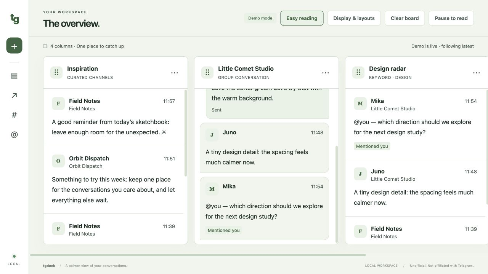
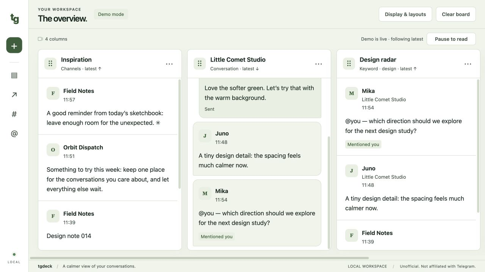
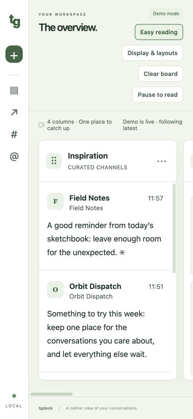
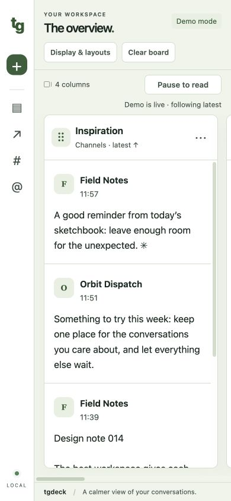
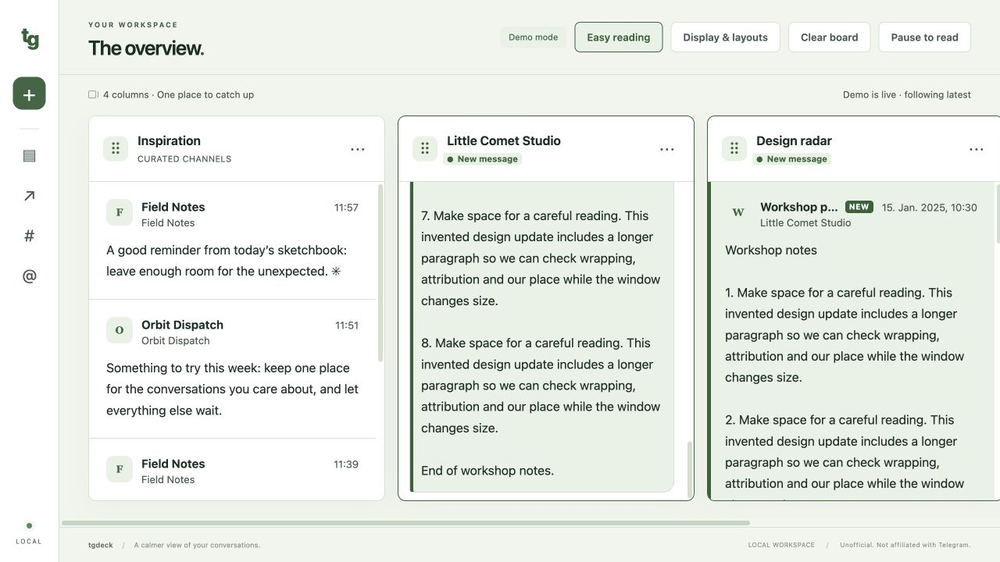
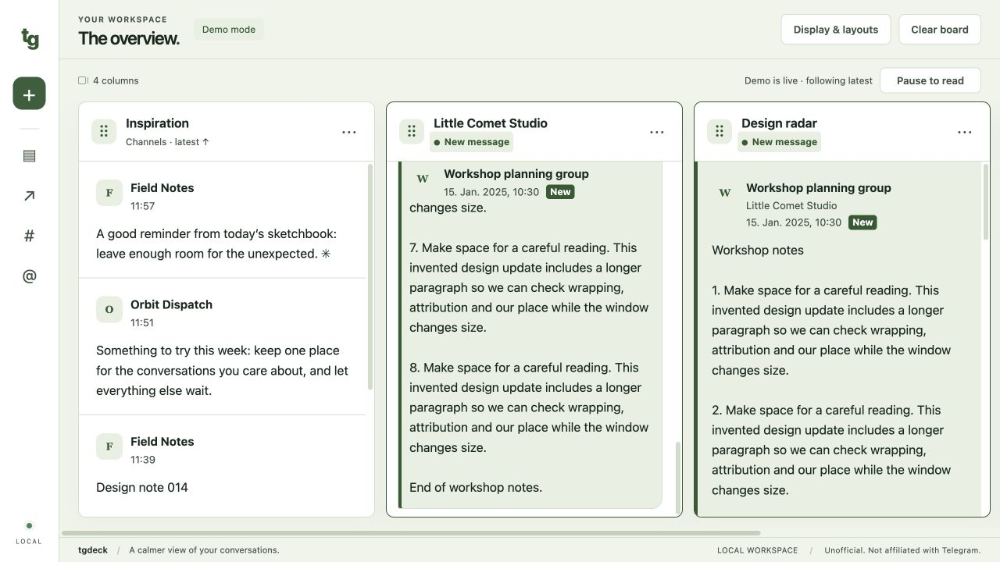

# Reading and monitoring UI review

Review date: 2026-10-23. All messages, chats and drafts in this review are invented.
Captures show only the demo page, without browser chrome, startup URLs or tokens.
The existing working UI was the baseline; this pass adds no account or messaging features.

## Problems and acceptance criteria, defined before implementation

| Problem | Observed evidence | Effect on reading | Acceptance criterion |
| --- | --- | --- | --- |
| Controls consume the reading area | At 390 × 844 the header was 223 px tall. The first walkthrough had a 365 px feed; the saved baseline, after separate existing footer work, has approximately 400 px. | Only a few messages fit, and Pause competes with display and demo controls. | At least 450 px of feed at 390 × 844, at least 430 px at 1280 × 720; no horizontal page overflow; controls remain reachable. |
| Attribution competes with arrival and time metadata | The 105 px sender “Orbit Dispatch” had only 102 px available in a narrow feed. A long latest chat message followed the bottom correctly but put its header at −819 px, while the feed started at 233 px. | Readers must infer the sender or scroll away from the latest content to find it. | Sender names wrap without clipping; time and New have their own space; the sender of a message taller than the feed remains visible; sampled text contrast is at least 4.5:1. |
| Paused reading loses its anchor on reflow | At 700 → 500 px wide, a paused message moved from −24.91 to +56.67 px relative to the feed: 81.59 px drift. | Resizing interrupts reading even when updates are paused. | Same visible message and offset within 2 px after resize and reorder, when scroll limits permit; live mode still follows the latest edge; drafts survive updates. |

## Changes and results

- Header controls are more compact. Easy reading lives in Display & layouts; Pause/Resume sits with live status. The redundant floating jump control is removed; the header arrival marker and rail counts remain available. At 390 × 844 the header is 117 px and the feed is 518–520 px. At 1280 × 720 the feed is 455–456 px. Small variations reflect browser display scaling.
- Sender names occupy a full wrapping line. Date/time and New share a separate row; duplicate channel/sender names are omitted. Only messages taller than the feed have a sticky attribution header. The long-message header now sits at the feed’s top (207 px in the recorded check), while the chat stays within 0.5 px of its newest edge. Message text remains 16 px by default, at 1.6 line height. Sender/time/source metadata stays at least 12 px at all four text-size settings.
- New workspaces use bubbles. Saved style choices are preserved. Existing column widths, display choices, pointer dragging, keyboard reordering and automatic following remain available. Column subtitles include the latest-message direction.
- Paused positions now cache a message key and its offset before reflow, restore it after resizing, and preserve fractional scroll correction. The repeated 700 → 500 px check drifted by 0.22 px. Keyboard and pointer reordering each preserved the paused offset exactly.
- Focus outlines use the theme accent ink; feed outlines draw inside the scroll region. Theme background interpolation was removed to avoid a temporary low-contrast frame during theme changes.

## Repeatable scenarios

Run `node scripts/ui-demo.ts`, open its one-time loopback URL, then choose **Explore the demo**.
This uses the existing demo seeds, a fixed invented clock, and no account storage or Telegram connection.
Type commands into the runner’s terminal; do not include its startup URL in captures.

| Command | Scenario |
| --- | --- |
| `reset` | Restore the four original columns, medium widths, light theme, comfortable 16 px bubbles and seeded history. |
| `tick` | One standard demo arrival. |
| `burst` | 32 standard demo arrivals, distributed across the existing filters. |
| `long` | A long invented message, long sender and previous-year timestamp in the conversation and search columns. Other columns stay quiet. |
| `snapshot` | Rebuild from the current synthetic state, exercising position and focus restoration. |
| `composer` | Exercise the production composer with invented data in a synthetic Telegram-mode snapshot. This never creates a Telegram client. Use it only for draft checks; do not capture this variant. |
| `quit` | Stop the review server. |

Do not press Send in the composer scenario: sending is covered separately by the synthetic server regression suite. The review runner is intended for draft, selection and layout checks.

## State matrix and observed results

| State/task | Procedure | Result |
| --- | --- | --- |
| Live burst | `reset`, `burst`; inspect top of feeds and bottom of conversation | Every column follows its newest edge within 2 px. Offscreen columns retain their arrival counts/highlights. |
| Quiet columns | `reset`, `long` | Conversation/search update; channel/mention history remains unchanged. |
| Paused arrivals | `burst`, Pause, PageDown in Inspiration, `burst` | Visible messages, scroll offset and message count remain unchanged until resume. |
| Resume | Resume after the paused burst | New snapshot catches all columns up; feed history remains bounded at 50 messages. |
| Paused resize | Pause at 700 × 800, PageDown, resize to 500 × 800 | Same message; 0.22 px drift. |
| Keyboard reorder | Pause, focus Inspiration’s handle, Space, ArrowRight, Enter | Correct order, exact anchor preservation, focus restored to moved handle. |
| Cancel reorder | Space, End, Escape | Original order retained. |
| Pointer reorder | Drag Inspiration past Design radar | Correct order; exact paused anchor preservation. |
| Persistence | Resume and reload | New column order survives; live following resumes. |
| Draft + snapshot | `composer`, type a multiline invented draft, select one character, `burst`, `snapshot` | Draft, selection range and textarea focus unchanged. |
| Draft + layout | Pause, keyboard-reorder conversation, resize, resume | Draft and selection retained. Focus follows the control deliberately used. |
| Window sizes | CSS viewports 390 × 844, 500 × 800, 700 × 800, 768 × 800, 1024 × 600, 1280 × 720, 1440 × 900 | No root-page horizontal overflow, clipped sender/source metadata or column-title/control overlaps. Live following passes in every size. Board horizontal scrolling is intentional. |
| Arrangements | 18 px compact Grid and Focus; 300 px narrow conversation with long message | Live following and metadata wrapping pass. Grid’s two minimum-height rows use intentional board scrolling on short windows. |
| Keyboard focus | Tab through controls; use feed PageDown and reorder keys | Visible accent outlines; feed outline remains inside the clipped column. |

Browser assertions verify these recorded transitions. Raw synthetic measurements are in
[measurements.json](ui-review/measurements.json). The final viewport checks use root-document
scroll dimensions: fractional display scaling can make `body.scrollWidth` differ by one
pixel without causing page scrolling. Browser error/warning logs were empty during validation.

Text contrast uses computed foreground and effective opaque background colors with the
sRGB luminance formula. The sample includes message bodies, senders, timestamps, sources,
arrival labels, column status, live status and primary/pause controls. This is a focused
measurement, not a complete accessibility audit.

| Theme | Sage | Ocean | Rose | Amber |
| --- | ---: | ---: | ---: | ---: |
| Light: minimum sampled text contrast | 5.39:1 | 5.03:1 | 5.18:1 | 4.86:1 |
| Dark: minimum sampled text contrast | 5.59:1 | 5.69:1 | 5.93:1 | 5.45:1 |

Automated validation: `npm run check` passes 93 tests including five new reading-position
regressions for reflow, subsequent scrolling, snapshot/deletion anchors, subpixel drift and
scroll limits. `npm run guard` passes the indexed/history scan. Current changed source and
documentation are also scanned separately because the history guard does not include
unstaged or untracked content. No commit, push or publication is part of this review.

## Matching-viewport captures

The seed clock, content, settings and column order match within each before/after pair.
Viewport sizes are CSS pixels; image pixel density may vary with browser display scaling.
The long-message pair uses the same invented scenario and bubble style.

| State | Before | After |
| --- | --- | --- |
| 1280 × 720 |  |  |
| 390 × 844 |  |  |
| Long arrival, 1280 × 720 |  |  |

[Dark-theme long-message check](ui-review/after-dark-1280.jpg).

## Remaining uncertainty

No fresh human tester has participated. Ask someone unfamiliar with the board to identify
the latest message, sender and column without guidance, then pause, find an older message,
resize and resume. Record time, errors and whether the New labels and direction cues are
understood. This will test discoverability and perceived calm beyond the measured layout.

Resizing preserves a message-relative offset, not an exact word within a rewrapped paragraph.
The anchor can also be clamped if content becomes shorter than the feed or its message is
removed. Sticky attribution uses some reading space for very long messages; perceived benefit
needs human testing. Browser checks used the in-app browser, not an independent cross-engine
or screen-reader suite. Tiny windows, unusually long translated date strings and continuous
real-world monitoring remain useful follow-up cases with synthetic content.
